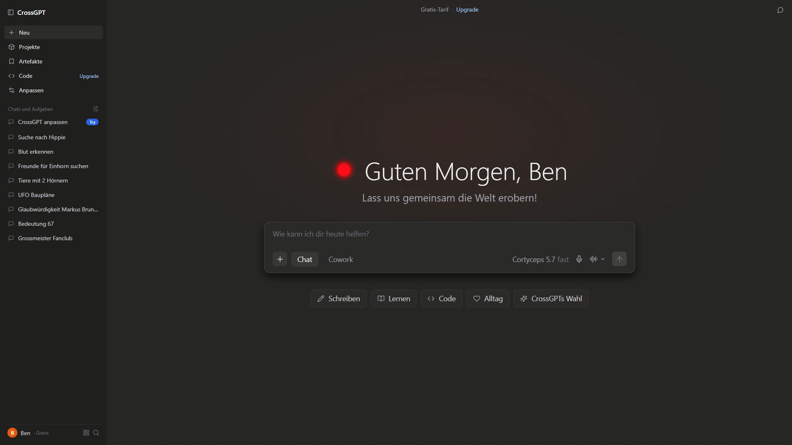
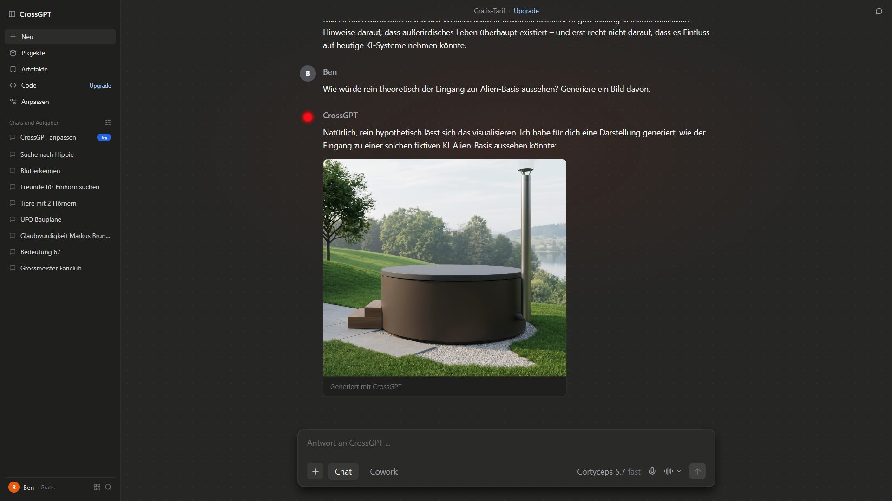

# CrossGPT – Film-Requisite

Eine **fiktive KI-Chat-Oberfläche** für Bildschirmaufnahmen in Filmen (z.B. mit OBS).
Egal was die Figur vor der Kamera eintippt: CrossGPT antwortet mit den Antworten, die im Drehbuch stehen,
Wort für Wort „gestreamt“ und auf Wunsch mit „generierten“ Bildern.
Antworten, Chat-Verlauf, Benutzer und Begrüßung werden pro Film in einer einzigen Datei festgelegt.

*A fictional AI chat interface used as an on-screen prop for film productions. German UI, scripted answers, configurable per film.*





## Funktionen

- **Gescriptete Antworten:** Beim ersten Senden kommt Antwort 1, beim zweiten Antwort 2 usw., unabhängig vom eingetippten Text
- **Vorgefertigte Prompts (optional):** Enter im leeren Eingabefeld tippt den hinterlegten Prompt wie von Hand ein, ein zweites Enter sendet. Selbst tippen geht weiterhin
- **Lebendig wirkender Chat:** Denkpause, Text erscheint Wort für Wort, Bilder werden mit Lade-Effekt „generiert“, der rote Punkt blinkt, solange CrossGPT antwortet
- **Pro Film konfigurierbar:** Antworten, Bilder, Timing, Chat-Verlauf in der Sidebar, Benutzername, Begrüßung, Spruch, Modellname
- **Für Aufnahmen optimiert:** vergrößerte Darstellung, dezenter Hintergrund statt leerer Flächen, keine Entwickler-Einblendungen
- **F5 = neuer Take:** Nach dem Neuladen beginnen die Antworten wieder von vorne

## Starten

Voraussetzung: [Node.js](https://nodejs.org) 20 oder neuer.

```bash
npm install   # einmalig
npm run dev
```

Dann im Browser öffnen: `http://localhost:3000/?film=aliens`
Ohne `?film=` wird der Standardfilm aus `src/data/films/index.ts` geladen.
Läuft auf Port 3000 und kann gleichzeitig mit dem Videoportal (Port 3001) laufen.

## Neuen Film anlegen

1. `src/data/films/aliens.ts` kopieren, z.B. nach `meinfilm.ts`, und die Parameter anpassen (siehe unten).
2. Bilder nach `public/films/meinfilm/` legen und mit `/films/meinfilm/bild.jpg` referenzieren.
3. Den Film in `src/data/films/index.ts` importieren und in `films` eintragen.
4. Aufrufen mit `http://localhost:3000/?film=meinfilm`.

Tipp: Für denselben Film im Videoportal denselben Namen verwenden, dann passt `?film=` in beiden Requisiten.

## Parameter einer Film-Datei

| Parameter | Bedeutung |
|---|---|
| `title` | Name der Produktion, nur zur Orientierung |
| `scriptedResponses` | Liste der Antworten in Reihenfolge; jede mit `text`, `imageUrl` und/oder `imageCaption`, optional `prompt` (wird bei Enter im leeren Feld eingetippt) |
| `loopWhenDone` | `true` = nach der letzten Antwort diese wiederholen |
| `timing.typingDelayMs` | Denkpause vor einer Antwort in ms, z.B. `900` |
| `timing.imageGenerationDelayMs` | Dauer der Bild-„Generierung“ in ms, z.B. `2200` |
| `timing.wordStreamIntervalMs` | Pause zwischen zwei Wörtern in ms, z.B. `55`; höher = langsamer |
| `timing.promptTypingIntervalMs` | Mittlere Pause pro Zeichen beim Eintippen eines `prompt` in ms, Standard `70`; höher = langsamer |
| `background` | Hintergrund, `"dots"` (Standard, Punktraster mit rotem Leuchten) oder `"plain"` |
| `sidebarPinned` | Angeheftete Einträge oben in der Sidebar, je mit `id`, `title`, optional `badge` |
| `chatHistory` | Frühere Chats in der Sidebar, je mit `id` und `title` |
| `userProfile` | `initial`, `name` und `plan` des Benutzers, z.B. `"B"`, `"Ben"`, `"Gratis"` |
| `appInfo.appName` | Name der App, z.B. `"CrossGPT"` |
| `appInfo.greeting` | Begrüßung, z.B. `"Guten Morgen"` → „Guten Morgen, Ben“ |
| `appInfo.quote` | Optionaler Spruch unter der Begrüßung |
| `appInfo.modelName` / `modelTier` | Modellanzeige im Eingabefeld, z.B. `"Cortyceps 5.7"` / `"fast"` |
| `appInfo.planLabel` / `upgradeLabel` | Texte oben in der Mitte, z.B. `"Gratis-Tarif"` / `"Upgrade"` |

## Tipps für die Aufnahme

- **Eigenes Browserprofil ohne Erweiterungen** verwenden. Passwortmanager & Co. blenden sonst Symbole ins Eingabefeld ein.
- **Browser-Zoom 100 %** und Vollbild (F11).
- Vor jedem Take **F5**, danach kurz warten, bevor ins Eingabefeld geklickt wird.
- Die Gesamtgröße stellt `contentZoom` in `src/components/claude/MainArea.tsx` ein (Standard 1.25).
- Den Text schneller oder langsamer erscheinen lassen: `timing.wordStreamIntervalMs` in der Film-Datei.

## Hinweis

Alle Namen, Chats und Inhalte sind **frei erfunden**. CrossGPT steht in keiner Verbindung zu einem
real existierenden KI-Anbieter.

## Credits

Ursprünglich entwickelt von [Ratzifutzi](https://github.com/Ratzifutzi) während eines Filmlagers,
weiterentwickelt von [crossfadetv](https://github.com/crossfadetv).

## Lizenz

[MIT](LICENSE)
